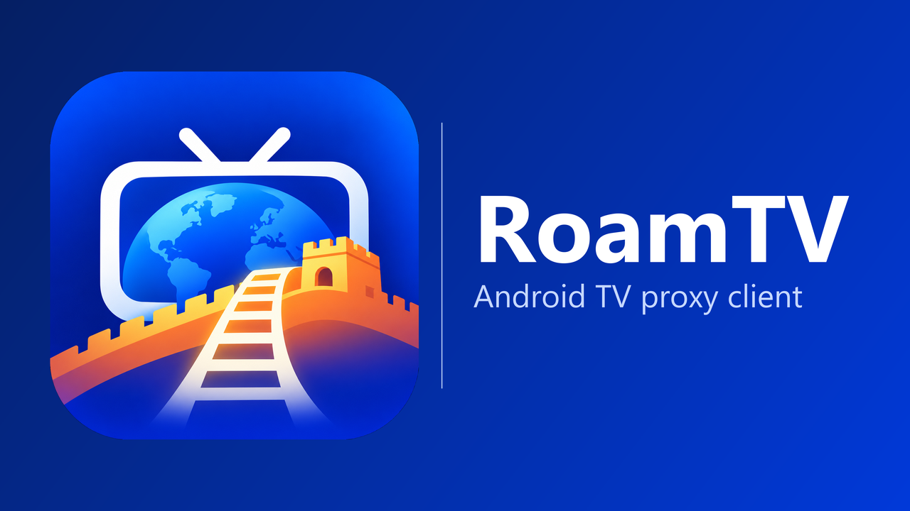
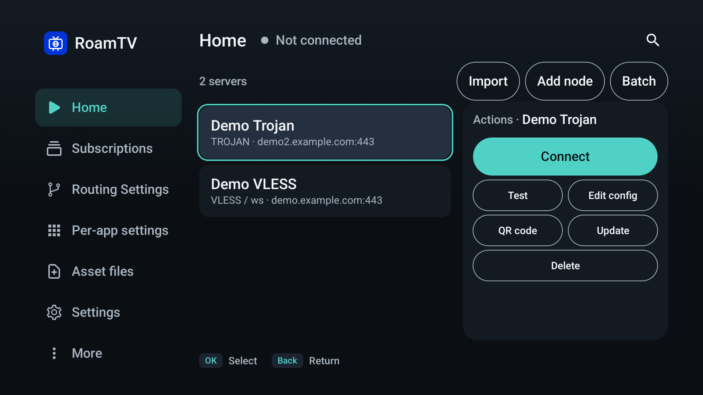

**简体中文** | [English](README.en.md)

# RoamTV



RoamTV 是面向 **Android TV 和 Google TV** 的 Xray/V2Ray 代理客户端。它连接你已有的服务器或订阅，全部操作可用电视遥控器完成：方向键移动焦点，OK 选择，返回上一级，菜单键（或页面上的“更多”按钮）打开当前项的操作。

RoamTV 不提供代理服务器、账号或 VPN 服务。你需要自备节点或订阅。



[](https://developer.android.com/about/versions/oreo)
[](https://kotlinlang.org)
[](https://github.com/fuzhengqu/RoamTV/releases)

## 适用对象

- Android TV、Google TV 或 Android TV 盒子，系统为 Android 8.0（API 26）及以上。
- 已有 VLESS、VMess、Shadowsocks、Trojan、WireGuard、SOCKS 或 HTTP 代理服务器，或已有的 Xray/V2Ray 订阅。
- 希望在沙发上用遥控器管理连接，不需要手机式触控界面或额外遥控 App。

## 功能

**电视端界面**

- 每个任务一个页面，5% 过扫描安全边距，清晰的焦点环和底部按键提示。
- 所有操作均可用方向键、OK、返回和菜单键完成。
- 首页支持播放/暂停键快速连接或断开。
- 首页操作栏集中 Connect/Disconnect、Test、Edit、二维码、更新订阅和删除。

**节点与订阅**

- 手动节点和分组，支持剪贴板、本地文件、手机配对页面（二维码 + 一次性配对码）以及完整 JSON 配置导入。
- 订阅分组支持更新、重命名和删除。
- 节点编辑器覆盖 VMess、VLESS、Shadowsocks、SOCKS、HTTP、Trojan、WireGuard、Hysteria2 和自定义配置；实际连接能力见[限制](#限制)。
- 搜索、排序、延时测试和实时代理速度。

**路由与 DNS**

- 域名、IP、端口、进程和入站标签路由规则。
- 域名策略、DNS 服务器和 DNS 路由。
- 分应用代理。
- `geoip.dat` 和 `geosite.dat` 位于应用私有 `app_assets` 目录；资源文件页面显示大小和日期，并支持通过 URL、本地文件或“下载全部”更新。

**连接模式**

- VPN 模式：通过 Xray 和 hev-socks5-tunnel 建立系统级 TUN。
- 仅代理模式：本地 SOCKS/HTTP 代理，不建立系统 VPN。
- Root 模式：通过内置 `libhevsockstun.so` 建立 TUN。

**无需摄像头的导入**

- 电视显示二维码，手机打开局域网配对页面。
- 手机用一次性会话密钥和配对码加密后，通过局域网发送配置。
- 不使用摄像头、账号或云端中转。

**运维**

- 连接日志、级别选择和搜索。
- 通过系统文件选择器备份和恢复配置。
- 更新检查、开源许可和 About 页面（显示内置 Xray 和 hev-socks5-tunnel 版本）。

## 协议与 ABI

内置 **Xray-core** 支持：

- VLESS（含 Reality 和 XTLS 流控）
- VMess
- Shadowsocks
- Trojan
- WireGuard
- SOCKS 和 HTTP（出站）

Hysteria2 的编辑字段和分享链接解析仍保留，以兼容导入的配置；但内置 Xray 核心没有 Hysteria2 出站。实际连接请使用上面的协议。

发布 APK 覆盖：

| ABI | 典型设备 |
|---|---|
| `armeabi-v7a` | 较老的 32 位电视和电视盒子 |
| `arm64-v8a` | 大多数当前电视和盒子 |
| `x86` / `x86_64` | 模拟器和 Intel 平台盒子 |
| `universal` | 任意设备，体积更大 |

## 安装

1. 打开 [Releases](https://github.com/fuzhengqu/RoamTV/releases)，下载与设备 ABI 匹配的 APK。常见电视用 `arm64-v8a`，较老的 32 位设备用 `armeabi-v7a`。
2. 允许文件管理器或浏览器安装应用，然后在电视上打开 APK。
3. 也可以使用 ADB 侧载：

   ```sh
   adb install -r RoamTV_<版本>_arm64-v8a.apk
   ```

4. 打开 RoamTV，导入节点或订阅，选择节点并连接。首次使用 VPN 模式时，Android 会显示 VPN 授权确认。

每个 APK 都附带 `.sig` 签名文件，发布页还提供 `RoamTV-public-key.asc`。安装非自行编译的版本前，建议先校验签名。

## 手机导入

1. 在电视上打开“导入”，选择手机/配对选项。
2. 电视显示二维码和一次性配对码。
3. 用手机扫描二维码，输入配对码，粘贴配置或订阅地址。
4. 手机加密后通过局域网发送给电视；配对会话会在短时间内过期。

电视不打开摄像头。手机页面由电视提供，不加载第三方脚本。

## 隐私

RoamTV 不包含分析、广告或遥测。节点、设置和日志保存在设备本地；网络请求只发往你配置的服务器、订阅、更新地址和资源地址。具体数据与端点见 [PRIVACY.md](PRIVACY.md)。

## 限制

- 不提供服务器、账号或订阅服务。
- Hysteria2 配置可以保存和编辑，但内置 Xray 核心无法连接；TUIC 未实现。
- 部分流媒体服务会封禁代理/VPN 流量，与客户端无关。
- 界面为电视设计，可在手机和平板上运行，但不是触控优先的手机客户端。
- Root 模式取决于设备的 root 实现，原厂电视通常不可用。
- 真机验证覆盖 Sony BRAVIA 上的 VLESS，以及模拟器上的 UI、导入、路由、备份和设置；其他协议有单元测试覆盖，但发布记录中没有真实服务器验证。

## 开发

- Android 工程位于 `android/`（Kotlin、Gradle Kotlin DSL、Compose for TV）。
- 工具链、原生库构建与发布复现：[docs/COMPLIANCE.md](docs/COMPLIANCE.md)。
- 内置核心版本和更新流程：[docs/NATIVE_CORES.md](docs/NATIVE_CORES.md)。
- 电视布局基线：[docs/UI_BASELINE.md](docs/UI_BASELINE.md)。
- 所有构建工具位于仓库内的 `.tooling/` 目录，不修改系统级环境变量。

## 许可证

RoamTV 是依据 **GNU 通用公共许可证第 3 版** 授权的自由软件。修改声明、上游来源标注、第三方许可文本与对应源码提供方式见 [LICENSE](LICENSE)、[NOTICE](NOTICE) 与 [docs/COMPLIANCE.md](docs/COMPLIANCE.md)。

本项目是独立衍生作品；上游作者与本修改无关，亦未为本修改背书。本项目不提供担保。
