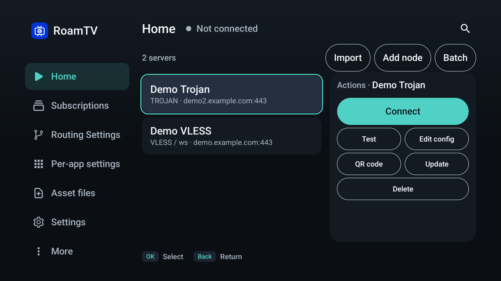
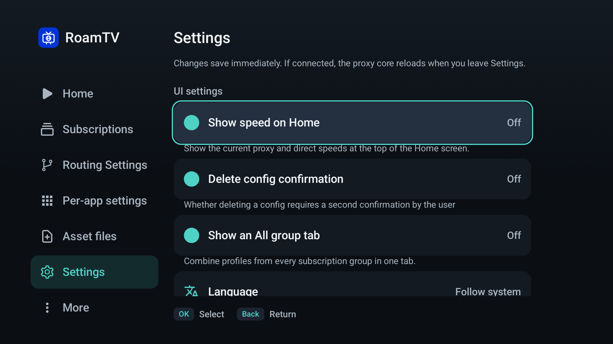
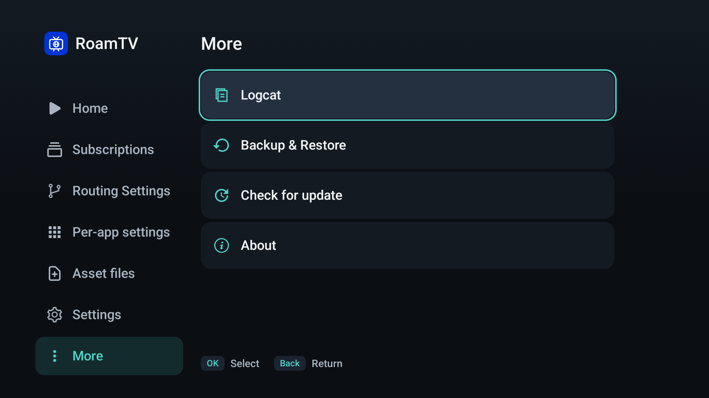
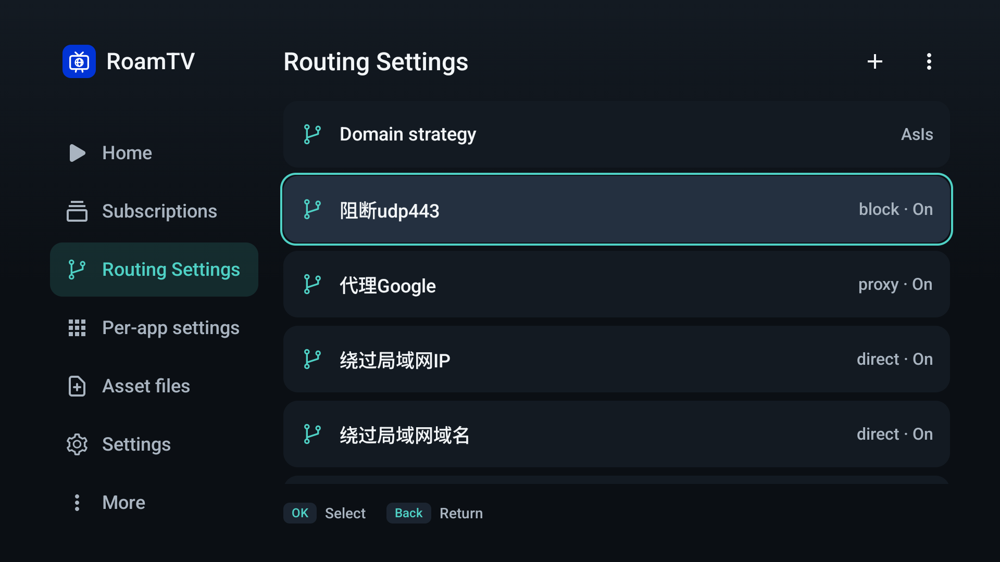
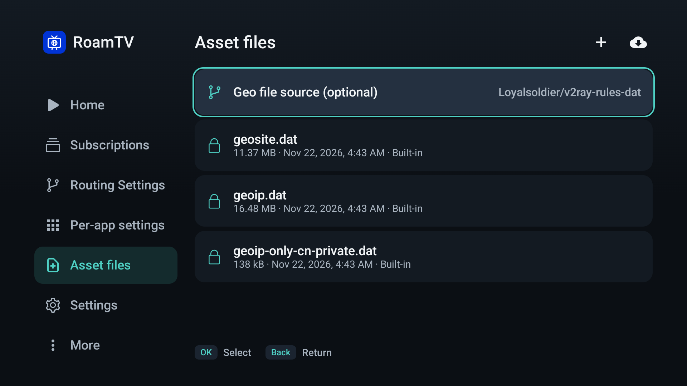
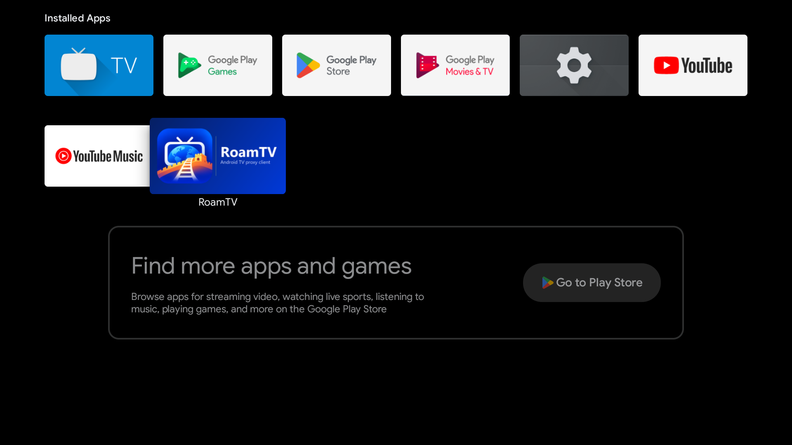

# TV UI baseline (v1.14)

This document freezes the television layout shipped in **v1.14**. Later
features must reuse these components and measurements. The baseline is a
behavioral contract, not a suggestion: a change to any value below needs its
own task requirement and before/after real-TV screenshots.

Version 1.15 changes branding only (launcher icon, TV banner, sidebar mark,
documentation). It does not change this layout.

## Frame

| Item | Value |
|---|---|
| Overscan | 5% of the current width and height on every edge (`TvOverscan`) |
| Background | dark vertical gradient; optional Monet palette on Android 12+; no light theme |
| Left rail | 200dp wide, full height |
| Rail header | 64dp high, 12dp horizontal padding, 32dp mark, 10dp gap |
| Rail item | 52dp high, 12dp corner radius, 14dp horizontal padding, 24dp icon |
| Top bar | 64dp high, back icon then title, actions on the right |
| Key-hint bar | 40dp high, pinned to the bottom, never scrolled away |
| Settings / More column | `widthIn(max = 560.dp)`, 4dp row spacing |
| Dialog | 32dp padding; focusable scroll lists start with 6dp top padding |

## Home

- Header: screen title, connection state, then Import / Add node / Batch on
  the right.
- Server list and action pane stay side by side. The pane is **320dp** when the
  content width is at least 700dp and **280dp** below that, with a 16dp gap.
- Pane content, top to bottom:
  1. full-width Connect / Disconnect (52dp);
  2. two equal columns: Test + Edit configuration;
  3. two equal columns: QR code + Update subscription;
  4. full-width Delete.
- Compact pane buttons are 42dp high. Every label is centered and every button
  keeps its own ring inside its bounds.
- The list and the pane scroll independently; the key-hint bar does not move.

## Settings and More

- The Settings and More pages use a single 560dp maximum column aligned to the
  start of the content area, not a centered card.
- Section headers use 16dp top padding; rows use 4dp vertical spacing.
- More is a top-level right-hand page (`TvRoute.More`), not a dialog. Logs,
  Backup, Update and About remain full-screen subpages; Back returns to More
  with the previously focused row selected.
- Settings rows open dialogs or subpages. A dialog always restores focus to the
  row that opened it.

## Buttons and focus

| Component | Height | Use |
|---|---|---|
| `TvPrimaryButton` | 52dp | Connect / Disconnect and primary confirmations |
| `TvSecondaryButton` | 52dp | Standard secondary actions |
| `TvCompactButton` | 42dp | The Home pane's two-column actions |
| `TvRailItem` | 52dp | Left-rail destinations |

- Corner radius: 12dp for surfaces and rail rows; pill shape for buttons.
- Focus ring: 2dp border inset by 2dp inside the component. The global focus
  scale and glow are disabled; do not reintroduce them.
- The first focusable row in a scroll list starts 6dp below the top bar. All
  four corners of its focus ring must be visible; use `TvSettingsColumn` for
  full-screen settings and form lists.
- Monet dynamic colour is a colour-only option in Settings. It uses the system
  wallpaper palette on Android 12+ and keeps the same dark surfaces, layout,
  focus and typography.
- Labels are centered in content-sized buttons. Primary Connect fills the pane
  width; compact actions fill their grid cell.
- Dialogs trap focus and restore it on dismissal. Destructive confirmations
  start on Cancel.

## Navigation and focus restoration

- Each route keeps its own `SaveableStateHolder`, so returning to a route
  restores its scroll position.
- More and Subscriptions remember the last focused row and restore it when the
  route is shown again.
- Home remembers the originating server GUID while the editor is open and
  returns focus to that node, not to the first row.
- Per-app settings focuses the first app on entry.
- Back walks the route stack first; on the root route it backgrounds the app
  without stopping the proxy service.
- Dialogs and the key-hint bar must remain reachable at 1.3x font scale and in
  RTL locales.

## Brand assets

- Launcher: the supplied square artwork; adaptive foreground limited to the
  66/108 safe zone; monochrome layer is a TV + globe mark.
- TV banner: 16:9, left square mark, right `RoamTV` and
  `Android TV proxy client`. Do not use an adaptive icon as the banner.
- Sidebar: 32dp `ic_brand_mark` (blue rounded square with the TV + globe mark).
- Store listing icon: 512x512 source artwork.

## Verification

The v1.14 layout was verified on a physical Sony BRAVIA (1920x1080 logical,
Android 12). Checks covered D-pad traversal, dialog focus, More/Back
restoration, Home editor return and Per-app first focus. The v1.15 branding
build rechecked Home and the rail at 1080p and 1280x720dp on an API 36
emulator; 4K, RTL, 1.3x font scale and TalkBack were not re-run.

Screenshots of the frozen layout live in `docs/assets/ui/`. A screenshot proves
appearance only; focus and state restoration still need a runtime check.
